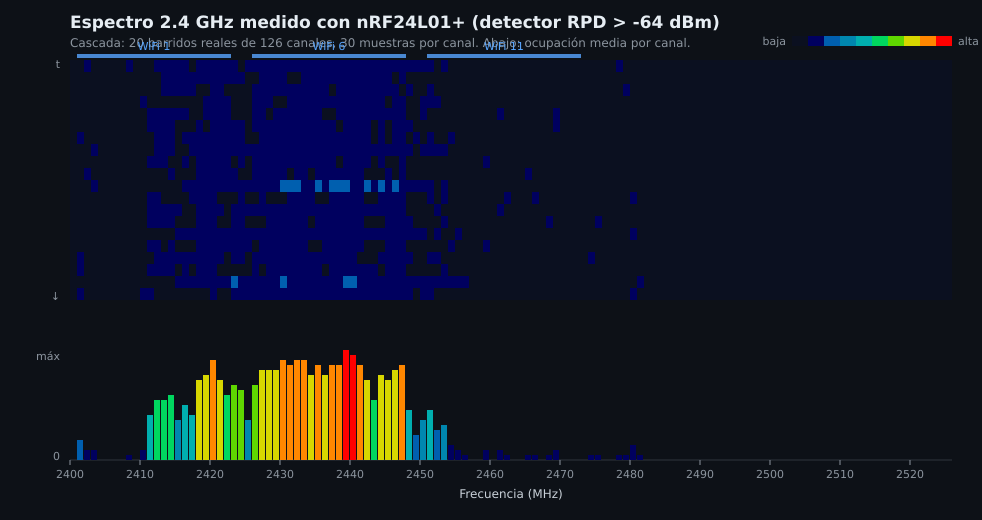

# Señales y Sistemas

[](LICENSE)


Portafolio de procesamiento de señales y comunicaciones: teoría implementada en Python,
ejercicios aplicados y proyectos que llevan los conceptos a hardware de radio y aplicaciones
reales.

Diseñado a partir de los **cursos de comunicaciones** de Ingeniería Eléctrica en la
Universidad Nacional de Colombia.

---

## Proyectos

| Proyecto | Descripción | Tecnologías |
|---|---|---|
| [**Analizador de espectro 2.4 GHz**](proyectos/analizador-espectro-2.4ghz-nrf24/) | Barre los 126 canales de la banda ISM de 2.4 GHz con un nRF24L01+ y un ESP32, y muestra la ocupación en una cascada a color con sonificación en tiempo real. | ESP32, nRF24L01+, Arduino, Python |
| [**Registro de ocupación 2.4 GHz**](proyectos/registro-ocupacion-2.4ghz/) | Registra la banda de 2.4 GHz durante horas y genera un espectrograma de largo plazo, mapas de ocupación por hora y el canal más limpio para enlaces nRF24. | ESP32, nRF24L01+, Python, Matplotlib |
| [**Medición FM en 98,1 MHz**](proyectos/medicion-fm-98.1mhz-rtl-sdr/) | Receptor WBFM propio que mide frecuencia central, ancho de banda ocupado (98 %) y potencia de una transmisión real, con análisis de saturación del ADC e intermodulación. | RTL-SDR, Python, NumPy, Tkinter |
| [**Receptor AM/FM con RTL-SDR**](proyectos/receptor-am-fm-rtl-sdr/) | Radio definida por software: PSD en tiempo real, demodulación AM y FM con audio sin cortes y estimación del índice de modulación. | RTL-SDR, Python, SciPy |
| [**De Fourier al WiFi/5G**](proyectos/de-fourier-al-wifi-5g/) | Cadena de transmisión digital paso a paso: FFT, filtrado, señales I/Q con Hilbert y modulación QAM, en un dashboard interactivo. | Python, SciPy, Streamlit |

<p align="center">
  
</p>

---

## Teoría

Cuadernos Jupyter con el desarrollo conceptual y su implementación numérica, organizados por tema.

| # | Tema | Cuadernos |
|---|---|---|
| 01 | [Fundamentos de Python](teoria/01-fundamentos-python/) | [Introducción a NumPy](teoria/01-fundamentos-python/introduccion-numpy.ipynb) · [Ejercicios](teoria/01-fundamentos-python/ejercicios-python.ipynb) |
| 02 | [Señales](teoria/02-senales/) | [Señales estándar](teoria/02-senales/senales-estandar.ipynb) · [Operaciones sobre señales continuas](teoria/02-senales/operaciones-senales-continuas.ipynb) · [Energía y potencia](teoria/02-senales/senales-energia-potencia.ipynb) |
| 03 | [Sistemas LTI](teoria/03-sistemas-lti/) | [Convolución](teoria/03-sistemas-lti/convolucion.ipynb) · [Autofunciones](teoria/03-sistemas-lti/autofunciones.ipynb) · [Linealidad e invarianza](teoria/03-sistemas-lti/linealidad-e-invarianza.ipynb) · [Sistemas en serie](teoria/03-sistemas-lti/sistemas-en-serie-gaussianas.ipynb) · [Circuito RLC (PDF)](teoria/03-sistemas-lti/demostracion-circuito-rlc.pdf) |
| 04 | [Fourier](teoria/04-fourier/) | [Series y transformadas de Fourier](teoria/04-fourier/series-y-transformadas-de-fourier.ipynb) · [Reconstrucción de señales](teoria/04-fourier/reconstruccion-de-senales.ipynb) |
| 05 | [Laplace](teoria/05-laplace/) | [Definición](teoria/05-laplace/definicion.ipynb) · [Propiedades](teoria/05-laplace/propiedades.ipynb) · [Transformada inversa](teoria/05-laplace/transformada-inversa.ipynb) |
| 06 | [Transformada Z](teoria/06-transformada-z/) | [Transformada Z](teoria/06-transformada-z/transformada-z.ipynb) |

## Prácticas

Ejercicios integradores y aplicaciones interactivas.

| Cuaderno | Contenido |
|---|---|
| [Análisis de señales continuas](practicas/analisis-de-senales-continuas.ipynb) | Cuatro ejercicios de operaciones sobre señales, espectro de Fourier y error de reconstrucción. |
| [Fourier aplicado: AM, THD y audio](practicas/fourier-aplicado-am-thd-audio.ipynb) | Modulación AM, distorsión armónica y factor de potencia en un rectificador, y clasificador de género musical por espectro. |
| [Explorador de sistemas de segundo orden](practicas/dashboard-sistemas-streamlit.ipynb) | Dashboard Streamlit de un circuito RLC: Bode, polos y ceros, respuestas al impulso, escalón y rampa, y modulación SSB-AM. |
| [Plantilla de dashboard Streamlit](practicas/dashboard-streamlit-prototipo.ipynb) | Estructura base de la aplicación multipágina y su publicación desde Colab. |

---

## Estructura

```text
.
├── proyectos/            # Proyectos completos, cada uno con su propio README
├── teoria/               # Cuadernos conceptuales organizados por tema
├── practicas/            # Ejercicios integradores y aplicaciones interactivas
├── docs/
│   └── material-del-curso/   # Enunciados y resúmenes de clase (material de referencia)
└── assets/img/           # Imágenes usadas por los cuadernos
```

## Uso

Los cuadernos se pueden abrir directamente en Google Colab con el botón incluido al inicio de cada
uno, o localmente:

```bash
git clone https://github.com/Jmontoyaor/SignalsandSystems-.git
cd SignalsandSystems-
pip install numpy scipy matplotlib jupyter
jupyter notebook
```

Cada proyecto en `proyectos/` documenta sus propios requisitos.

## Licencia

El código y los cuadernos originales se distribuyen bajo la [licencia MIT](LICENSE).
El material de `docs/material-del-curso/` (enunciados y resúmenes de clase) pertenece a sus
autores y se incluye solo como referencia.
