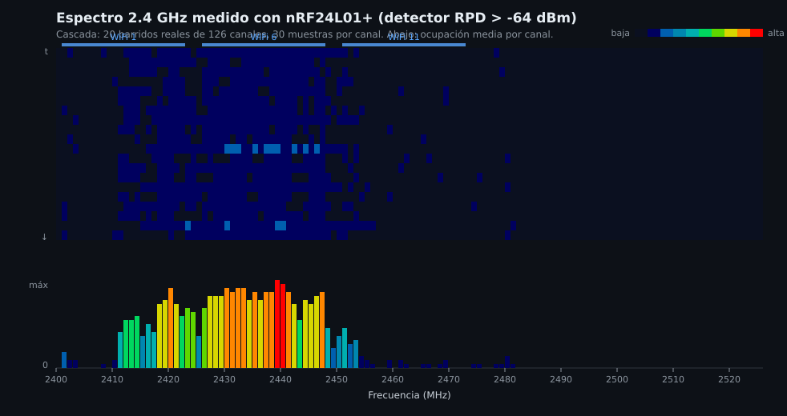

# Analizador de espectro de 2.4 GHz con nRF24L01+

Analizador de espectro de bajo costo para la banda ISM de 2.4 GHz construido con un
**ESP32-WROOM-32E** y un transceptor **nRF24L01+**. Barre los 126 canales de 1 MHz entre
2400 y 2525 MHz, estima la ocupación de cada uno y la muestra en tiempo real como una
cascada (*waterfall*) a color, con una sonificación que permite *escuchar* la actividad
de radio del entorno.



*Medición real en interiores: la actividad entre 2410 y 2450 MHz coincide con los canales
1 y 6 de WiFi; por encima de 2480 MHz la banda está prácticamente libre.*

---

## En qué consiste

La banda de 2.4 GHz la comparten WiFi, Bluetooth, dispositivos IoT, controles inalámbricos y
hornos microondas. Este proyecto convierte un módulo de radio de unos pocos dólares en un
instrumento para observar cómo se reparte esa banda en el dominio de la frecuencia.

| Concepto de señales | Cómo aparece en el proyecto |
|---|---|
| Representación en frecuencia | Cada columna de la cascada es un canal de 1 MHz; cada fila, un barrido completo. |
| Espectrograma (tiempo-frecuencia) | La cascada apila barridos sucesivos y muestra cómo cambia la ocupación en el tiempo. |
| Ancho de banda | Un canal WiFi ocupa unos 20 MHz: se ve como una franja ancha, no como una línea. |
| Detección de energía | El detector RPD indica si la potencia recibida supera unos -64 dBm. |
| Estimación estadística | Cada canal se muestrea 30 veces por barrido; el color es la fracción de detecciones. |
| Sonificación | El tono sigue la frecuencia del pico y la intensidad del ruido sigue la actividad total. |

### Funcionamiento

1. El ESP32 sintoniza el nRF24L01+ en el canal *k* (2400 + *k* MHz) y lo pone en recepción.
2. Tras ~130 µs de asentamiento consulta el registro **RPD** (*Received Power Detector*), que
   vale 1 si en ese canal hay una señal por encima de unos -64 dBm.
3. Repite el proceso en los 126 canales, 30 veces, y cuenta las detecciones por canal.
4. Convierte cada conteo en un nivel de 0 a 9 y envía una fila de texto por el puerto serie.
5. `spectrum_view.py` colorea cada fila en la terminal y genera el audio en el PC.

```text
nRF24L01+ ──SPI──► ESP32 ──USB serie──► PC: cascada a color + audio
```

---

## Hardware

| Componente | Notas |
|---|---|
| ESP32-WROOM-32E (DevKit) | Cualquier placa ESP32 con VSPI disponible. |
| nRF24L01+ | Módulo con antena impresa o con PA/LNA. |
| Condensador 10 µF | Entre VCC y GND del módulo, lo más cerca posible. Recomendado. |

### Conexiones

| nRF24L01+ (pin) | ESP32 |
|---|---|
| 1 GND | GND |
| 2 VCC | **3V3** (nunca 5 V) |
| 3 CE | GPIO4 |
| 4 CSN | GPIO5 |
| 5 SCK | GPIO18 |
| 6 MOSI | GPIO23 |
| 7 MISO | GPIO19 |
| 8 IRQ | sin conectar |

---

## Uso

### 1. Firmware

Requisitos: [Arduino IDE](https://www.arduino.cc/en/software) o `arduino-cli`, el núcleo
**esp32 by Espressif** y la biblioteca **RF24** de TMRh20.

```bash
arduino-cli core install esp32:esp32
arduino-cli lib install RF24
arduino-cli compile --fqbn esp32:esp32:esp32 firmware/nrf24_spectrum
arduino-cli upload  --fqbn esp32:esp32:esp32 -p /dev/ttyUSB0 firmware/nrf24_spectrum
```

El firmware funciona solo: en el monitor serie (115200 baudios) se ve la cascada en texto.

### 2. Visor a color con sonido

```bash
pip install pyserial
python tools/spectrum_view.py /dev/ttyUSB0          # con sonido (requiere pacat / PulseAudio)
python tools/spectrum_view.py /dev/ttyUSB0 --mute   # solo imagen
```

Cierre el monitor serie del IDE antes de ejecutarlo: el puerto admite un solo lector.

**Para probarlo:** reproduzca un video en el celular junto a la antena, active el Bluetooth
o encienda un horno microondas (este último llena la zona de 2450 MHz).

---

## Contenido

```text
analizador-espectro-2.4ghz-nrf24/
├── firmware/
│   ├── nrf24_spectrum/   # Analizador de espectro (programa principal)
│   ├── nrf24_diag/       # Diagnóstico SPI de bajo nivel: verifica cableado y módulo
│   └── dual_nrf24/       # Enlace entre dos nRF24 en el mismo bus SPI (en desarrollo)
├── tools/
│   └── spectrum_view.py  # Visor de cascada a color con sonificación
└── docs/
    └── espectro-2.4ghz.svg
```

### Diagnóstico de cableado

`nrf24_diag` lee los registros del módulo directamente por SPI, con resistencias internas de
pull-up y pull-down en MISO, para distinguir fallas:

| Resultado | Interpretación |
|---|---|
| `STATUS=0x0E CONFIG=0x08 SETUP_AW=0x03 RF_CH=0x2A` | Módulo y cableado correctos. |
| Todo `0x00` con pull-down y `0xFF` con pull-up | MISO flotando: el módulo no responde (CSN, MISO o GND). |
| `0xFF` incluso con pull-down | Algo fuerza MISO a nivel alto (módulo dañado o mal conectado). |

---

## Limitaciones

- El RPD es un detector de **un bit** (supera o no -64 dBm): el color representa la
  **ocupación** del canal, no su potencia en dBm.
- No demodula ni identifica el tipo de señal.
- Resolución fija de 1 MHz y un barrido completo cada ~2.5 s.

## Trabajo futuro

- Enlace de audio en vivo entre dos nRF24 (micrófono → ADC → radio → DAC → parlante).
- Selección automática del canal más limpio para enlaces nRF24.
- Visualización web con espectrograma acumulado.

## Licencia

[MIT](../../LICENSE)
