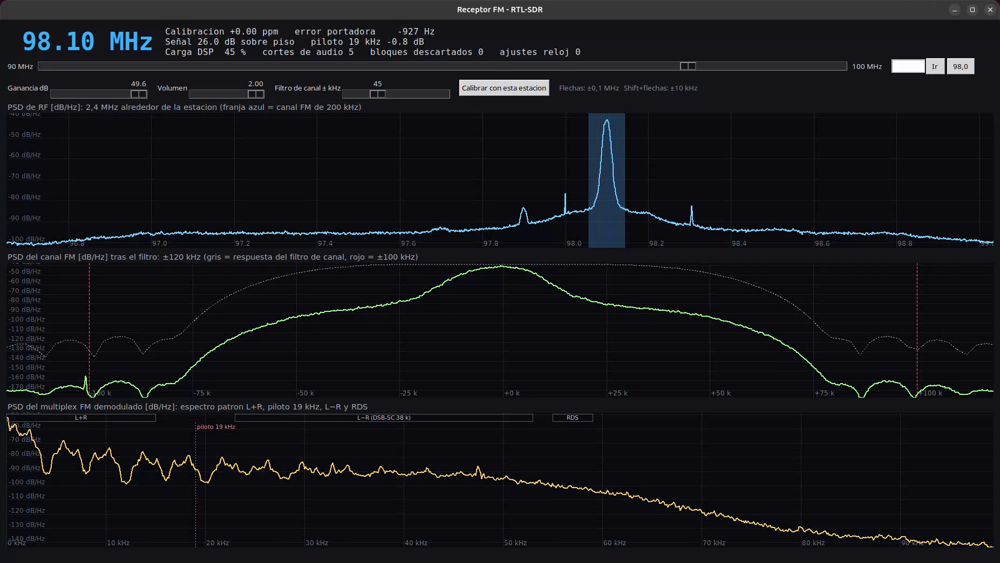
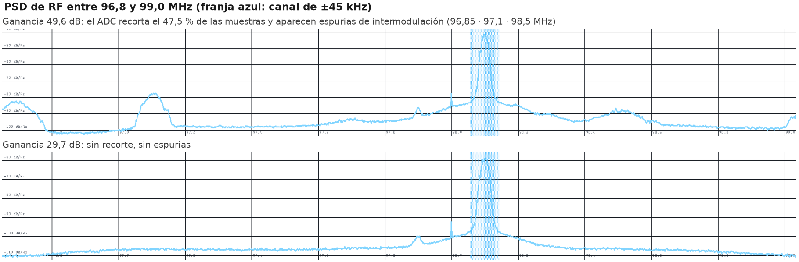

# Medición de una transmisión FM en 98,1 MHz con RTL-SDR

Recepción y caracterización de una transmisión FM con un receptor definido por software
propio. El programa sintoniza la banda de 90 a 100 MHz, reproduce el audio sin cortes y
mide en tiempo real la **frecuencia central**, el **ancho de banda ocupado (98 %)** y la
**potencia** del canal. El estudio incluye un análisis de la saturación del conversor y de
la intermodulación que produce según la ganancia del sintonizador.



*Interfaz del receptor en 98,10 MHz. De arriba abajo: PSD de RF (2,4 MHz alrededor de la
estación), PSD del canal tras el filtro con la respuesta del filtro superpuesta, y PSD del
múltiplex demodulado con las bandas L+R, piloto de 19 kHz, L−R y RDS.
[Video de la sesión (19 s)](docs/demo-receptor.webm) · [Informe completo (PDF)](docs/informe.pdf)*

---

## Resultados

Registro de 30 s, una lectura cada 0,5 s (58 lecturas por ganancia), filtro de canal de
±45 kHz y sin corrección de frecuencia (0 ppm).

| Medida | Ganancia 49,6 dB | Ganancia 29,7 dB |
|---|---|---|
| Frecuencia central | 98,09906 MHz | 98,09908 MHz |
| Desvío respecto a la sintonía | −942 ± 189 Hz | −922 ± 175 Hz |
| Ancho de banda ocupado (98 %) | 28,7 ± 2,8 kHz | 26,9 ± 2,8 kHz |
| Potencia del canal | +0,04 ± 0,25 dBFS ⚠ | −15,3 ± 0,7 dBFS |
| Potencia sobre el ruido | 45,9 ± 0,5 dB | 41,9 ± 0,7 dB |
| Piloto de 19 kHz sobre el ruido | 1,5 dB | 1,8 dB |
| Bloques recibidos / cortes de audio | 598 de 600 / 0 | 599 de 600 / 0 |

⚠ A 49,6 dB la lectura está limitada por el fondo de escala del conversor y no representa
la potencia real.

**Interpretación**

- **Frecuencia central.** La portadora está 0,93 kHz (−9,5 ppm) por debajo de la sintonía
  con ambas ganancias. El oscilador del NESDR SMArt v5 es un TCXO de 0,5 ppm, por lo que el
  corrimiento se atribuye principalmente al transmisor; confirmarlo requiere una referencia
  de frecuencia externa.
- **Ancho de banda.** El 98 % de la potencia ocupa unos 28 kHz, muy por debajo de los
  ~180 kHz de una emisora comercial (regla de Carson con 75 kHz de desviación): es una
  transmisión de desviación baja. La variación entre lecturas (20 a 37 kHz) sigue la
  amplitud instantánea del audio.
- **Estéreo.** El piloto de 19 kHz no sobresale del ruido: la transmisión es monofónica.

### Saturación del conversor e intermodulación

El RTL2832U digitaliza con 8 bits por componente I/Q. Subir la ganancia del sintonizador
mejora la sensibilidad mientras la señal no alcance el fondo de escala del conversor; con una
señal fuerte, la ganancia máxima lo satura.

| Ganancia (dB) | Muestras recortadas | Potencia (dBFS) |
|---|---|---|
| 49,6 | **47,52 %** | +1,2 |
| 40,2 | 0,00 % | −2,7 |
| 29,7 | 0,00 % | −13,2 |
| 19,7 | 0,00 % | −22,8 |
| 9,7 | 0,00 % | −31,9 |



Como la FM lleva la información en la fase, la frecuencia central y el ancho de banda medidos
casi no cambian con el recorte. Sin embargo, la no linealidad genera productos de
intermodulación en 96,85, 97,1 y 98,5 MHz que podrían confundirse con otras emisoras o
enmascarar una señal débil. **Ganancia recomendada para esta señal: 40,2 dB**, la mayor sin
recorte.

---

## Receptor

`receiver/receptor_fm.py` es un receptor WBFM completo en Python + NumPy, con interfaz
Tkinter. Recibe las muestras de `rtl_tcp`, lo que permite cambiar frecuencia, ganancia y
filtro sin reiniciar el dispositivo.

### Cadena de procesamiento

```text
                      LO −250 kHz              FIR de canal
RTL-SDR (rtl_tcp) ─► corrimiento digital ─► ±5 … ±115 kHz, ↓10 ─► discriminador FM ─┐
 2,4 MS/s, 8 bits                                240 kS/s           (múltiplex)       │
                                                                                      │
  parlantes ◄── aplay ◄── de-énfasis 75 µs ◄── FIR de audio 15,5 kHz, ↓5 ◄────────────┘
                              48 kS/s
```

| Etapa | Función |
|---|---|
| Corrimiento de 250 kHz | Aleja la estación de la componente de DC y de la imagen I/Q del centro de la banda. |
| Filtro de canal + ↓10 | FIR con ventana de Blackman por solapamiento (*overlap-save*). Selecciona la estación y evita *aliasing* al bajar a 240 kS/s. Su ancho se ajusta a la señal: ±45 kHz para esta transmisión, ±100 kHz para FM comercial. |
| Discriminador | Frecuencia instantánea a partir de ∠(z[n]·z*[n−1]): entrega el múltiplex FM en Hz. |
| Filtro de audio + ↓5 | Conserva L+R (hasta 15 kHz) y elimina piloto, L−R y RDS antes de bajar a 48 kS/s. |
| De-énfasis | Filtro de un polo con τ = 75 µs (norma de América). |

**Audio continuo.** Los filtros conservan su estado entre bloques (reiniciarlos produce
chasquidos); la lectura del SDR, el DSP y la salida de audio corren en hilos separados, con
0,3 s de precarga y una cola que compensa la deriva entre el reloj del SDR y el de la
tarjeta de sonido.

### Medidas del analizador de espectro

- **PSD:** método de Welch con ventana de Hann, normalizada al fondo de escala del conversor
  (dB/Hz relativos a FS) y suavizada en el tiempo.
- **Ancho de banda ocupado (98 %):** se resta el piso de ruido (mediana de la PSD de RF), se
  integra la potencia del canal y se buscan las frecuencias del 1 % y el 99 %.
- **Frecuencia central:** centroide de potencia de la PSD del canal, una vez restado el ruido.
- **Potencia:** integral de la PSD del canal, en dBFS y relativa al ruido en el mismo ancho.
  No se reporta en dBm porque el receptor no tiene calibración absoluta de potencia.

---

## Uso

### Requisitos

- Dongle RTL-SDR (medido con un Nooelec NESDR SMArt v5, RTL2832U + R820T).
- Linux con `rtl-sdr` (`rtl_tcp`), `python3-tk`, `aplay` (alsa-utils) y NumPy.

```bash
sudo apt install -y rtl-sdr python3-tk alsa-utils
pip install -r requirements.txt
```

### Interfaz gráfica

```bash
python3 receiver/receptor_fm.py -f 98.1 -g 40.2 --filtro 45
```

Flechas: ±0,1 MHz · Shift + flechas: ±10 kHz. La ventana incluye controles de ganancia,
volumen y ancho del filtro de canal, y un botón para calibrar el oscilador con una estación
fuerte (se niega a hacerlo con menos de 10 dB de SNR).

### Medición sin interfaz

```bash
# Registro de 30 s a CSV: fc, desvío, BW 98 %, f1/f2, potencia, SNR, piloto y cortes
python3 receiver/receptor_fm.py --prueba 30 -f 98.1 -g 29.7 --filtro 45 --sin-audio --csv medidas.csv

# Guardar el audio demodulado
python3 receiver/receptor_fm.py --prueba 10 -f 98.1 --wav audio.wav

# Calibrar la frecuencia con una emisora fuerte (puede estar fuera de 90-100 MHz)
python3 receiver/receptor_fm.py --calibrar-en 105.7
```

`python3 receiver/receptor_fm.py --help` lista todas las opciones.

---

## Contenido

```text
medicion-fm-98.1mhz-rtl-sdr/
├── receiver/
│   └── receptor_fm.py        # Receptor WBFM con interfaz, medidas y modo de registro
├── docs/
│   ├── informe.pdf           # Informe técnico del laboratorio
│   ├── interfaz.png
│   ├── intermodulacion.png
│   └── demo-receptor.webm    # Video de la interfaz sintonizada
└── requirements.txt
```

## Limitaciones

- Potencia en dBFS, no en dBm: falta una referencia de nivel conocido.
- Sin referencia de frecuencia externa no se puede separar el error del receptor del error
  del transmisor.
- La frecuencia central como centroide es adecuada para FM con audio continuo; para
  modulaciones digitales con espectro asimétrico conviene usar el punto medio entre bordes.
- Audio solo en Linux (`aplay`).

## Autores

- Juan Diego Moreno
- Cristian Castaño Saldarriaga
- Juan Fernando Montoya Ortiz
- Jerónimo Chivata

Teoría de Señales, 2026-2 · Universidad Nacional de Colombia

## Licencia

[MIT](../../LICENSE)
