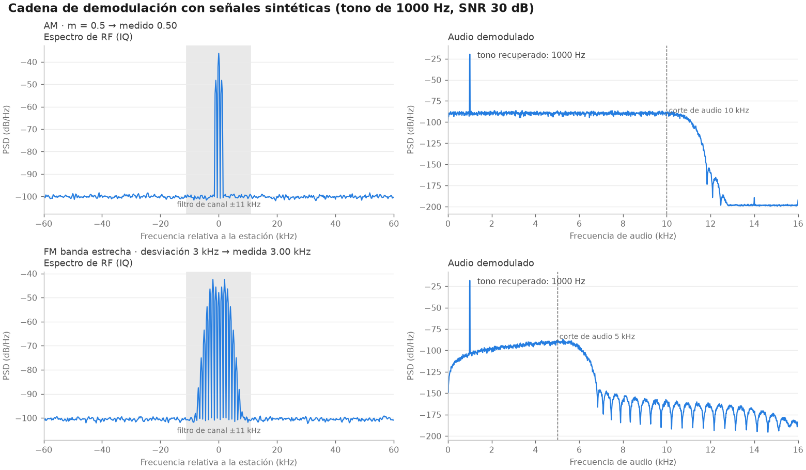

# Receptor AM/FM con RTL-SDR

Receptor de radio definido por software escrito en Python para un dongle **RTL-SDR**.
Muestra en tiempo real la densidad espectral de potencia (PSD) de la señal de RF, demodula
**AM**, **FM de banda ancha** (radio comercial) y **FM de banda estrecha**, reproduce el
audio por la tarjeta de sonido y estima la frecuencia de la moduladora y el índice de
modulación.

Desarrollado a partir del taller de RTL-SDR del curso de Señales y Sistemas, que partía de
un script de PSD básico.



*La misma cadena de demodulación del receptor, alimentada con señales sintéticas: recupera el
tono de 1 kHz, la profundidad de AM (m = 0.50) y la desviación de FM (3.00 kHz).*

---

## En qué consiste

El RTL-SDR entrega muestras complejas **IQ** de un trozo del espectro alrededor de la
frecuencia sintonizada. Todo lo demás (desplazar la estación, filtrar el canal, demodular y
llevar el resultado a la banda de audio) ocurre en software, con las herramientas del curso.

| Concepto de señales | Cómo aparece en el proyecto |
|---|---|
| Señal analítica / IQ | Las muestras complejas permiten distinguir frecuencias positivas y negativas. |
| Desplazamiento en frecuencia | Multiplicar por e<sup>jω₀n</sup> lleva la estación a 0 Hz, con fase continua entre bloques. |
| Filtrado FIR | Filtros pasa-bajos con ventana de Kaiser (60 dB de rechazo) por convolución con FFT. |
| Decimación | 1024 kS/s → 256 kS/s → 32 kS/s, filtrando antes de cada reducción para evitar *aliasing*. |
| Detección de envolvente | AM: \|x[n]\| = A<sub>c</sub>(1 + m·s[n]). |
| Discriminador de FM | La frecuencia instantánea sale de la diferencia de fase entre muestras consecutivas. |
| Regla de Carson | El ancho del filtro de canal es la desviación máxima más la frecuencia máxima de audio. |
| Pre/de-énfasis | Filtro de un polo con τ = 75 µs para FM comercial en América. |
| Estimación espectral | PSD por el método de Welch (segmentos de 4096 puntos, solape del 50 %). |

### Cadena de procesamiento

```text
RTL-SDR ─► IQ 1024 kS/s ─► mezclador (−fs/4) ─► filtro de canal ─► ↓4 ─► 256 kS/s
                                                                          │
          ┌───────────────────────────────────────────────────────────────┘
          ▼
  AM: envolvente |x| / nivel de portadora     FM: discriminador de fase (+ de-énfasis)
          │                                         │
          └───────────────► bloqueo de DC ─► filtro de audio ─► ↓8 ─► 32 kS/s ─► parlante
```

La estación se sintoniza fs/4 por debajo del centro del sintonizador para que no caiga sobre
la componente de DC que el RTL-SDR introduce en el centro del espectro.

### Tiempo real sin cortes

La primera versión leía las muestras de forma síncrona y perdía entre el 16 y el 30 % de los
bloques mientras procesaba, lo que entrecortaba el audio. El receptor separa el trabajo en
tres hilos:

```text
librtlsdr (lectura asíncrona) ─► cola de bloques IQ ─► hilo de demodulación ─► búfer circular ─► callback de audio
```

El búfer de audio arranca con 0.5 s de reserva y limita la latencia a 4 s. En una prueba de
20 s el receptor procesó el 100 % de los bloques, sin pérdidas ni cortes de audio.

---

## Modos

| Modo | Uso | Desviación máx. | Audio hasta | Filtro de canal |
|---|---|---|---|---|
| `am` | Generador de laboratorio | — | 10 kHz | ±11 kHz |
| `fm_wide` | Radio comercial (88–108 MHz) | 75 kHz | 15 kHz | ±91 kHz |
| `fm_narrow` | Transmisores de banda estrecha | 5 kHz | 5 kHz | ±11 kHz |

El filtro de canal incluye un margen de 1 kHz para tolerar pequeños errores de sintonía.

---

## Uso

### Requisitos

- Dongle RTL-SDR (probado con un Nooelec NESDR SMArt v5, sintonizador R820T).
- Linux con `rtl-sdr`, `librtlsdr-dev` y `python3-tk`.

```bash
sudo apt install -y rtl-sdr librtlsdr-dev python3-tk python3-venv
python3 -m venv venv
venv/bin/pip install -r requirements.txt
tools/check_setup.sh        # verifica paquetes, dongle, librerías y driver
```

### Receptor

Edite los parámetros al inicio de [`receiver/rtl_sdr_receiver.py`](receiver/rtl_sdr_receiver.py):

```python
STATION_FREQ_HZ = 70_000_000  # frecuencia de la estación
GAIN_DB = 40.2                # ganancia manual (vigile el indicador de saturación del ADC)
MODE = "am"                   # "am", "fm_wide" o "fm_narrow"
```

y ejecute:

```bash
./run.sh
```

La ventana muestra el espectro de RF con el filtro de canal y, debajo, el espectro del audio
demodulado con el tono detectado. La terminal informa la frecuencia de la portadora, el
índice de modulación, el porcentaje de saturación del ADC y el estado del búfer de audio.
Ctrl+C o cerrar la ventana detiene la adquisición.

### Demostración sin hardware

```bash
venv/bin/python tools/offline_demo.py
```

Genera señales AM y FM sintéticas con ruido (SNR 30 dB), las pasa por `Receiver.demodulate()`
y escribe `docs/offline_demo.png`. Sirve para verificar la cadena de demodulación sin dongle:

```text
AM:        tone  1000.0 Hz | depth m = 0.502 (expected 0.5)
FM narrow: tone  1000.0 Hz | deviation = 2999 Hz (expected 3000)
```

---

## Contenido

```text
receptor-am-fm-rtl-sdr/
├── receiver/
│   └── rtl_sdr_receiver.py  # Receptor: PSD en tiempo real + demodulación AM/FM con audio
├── tools/
│   ├── check_setup.sh       # Diagnóstico de la instalación y del dongle
│   └── offline_demo.py      # Verificación de la cadena con señales sintéticas
├── docs/
│   └── offline_demo.png
├── run.sh
└── requirements.txt
```

## Limitaciones

- FM comercial en mono: no decodifica el estéreo (piloto de 19 kHz) ni RDS.
- La sintonía y el modo se cambian editando el script, no desde la interfaz.
- `pyrtlsdr` 0.3.0 depende de `pkg_resources`, por eso se fija `setuptools<81`.

## Licencia

[MIT](../../LICENSE)
