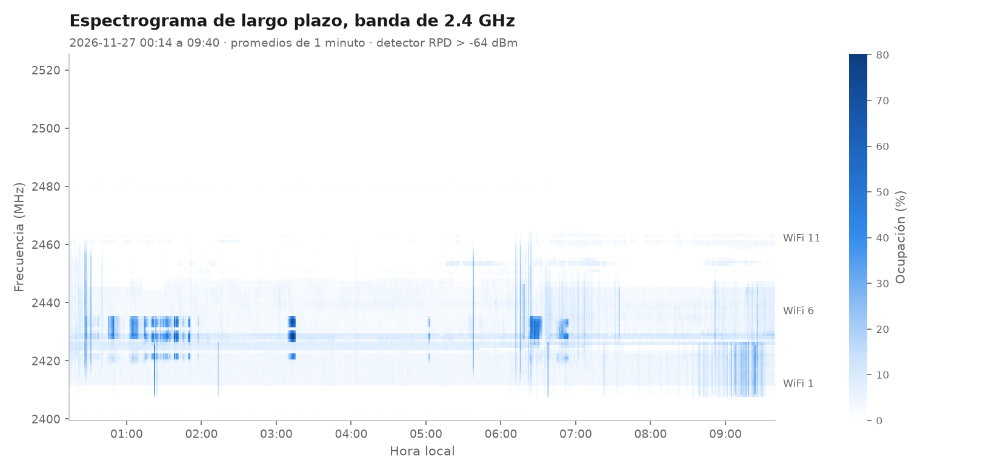
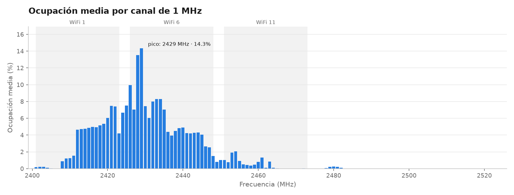
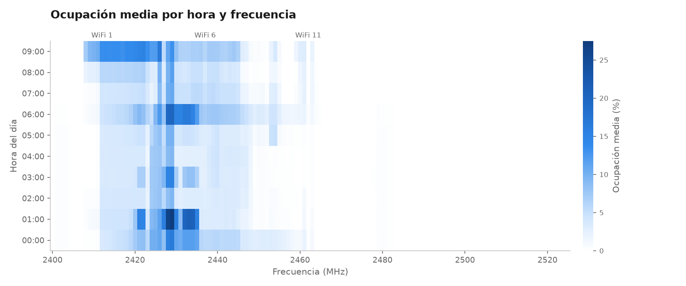
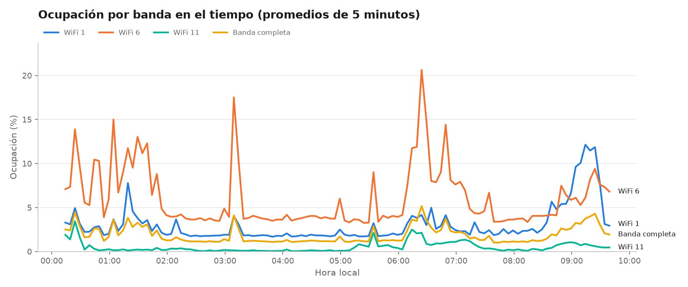

# Registro de ocupación de 2.4 GHz durante horas

Registrador de larga duración para la banda ISM de 2.4 GHz construido con un
**ESP32-WROOM-32E** y un **nRF24L01+**. Barre los 126 canales de 1 MHz entre 2400 y
2525 MHz cada ~2.6 s, guarda cada barrido con su marca de tiempo en un CSV y luego un
script de Python lo convierte en un espectrograma de largo plazo, mapas de ocupación por
hora y una recomendación del canal más limpio para enlaces nRF24.

Es la continuación del [analizador de espectro en tiempo real](../analizador-espectro-2.4ghz-nrf24/):
el mismo detector, pero observado durante horas en lugar de segundos.



*Medición real en interiores durante 9 h 27 min (00:14 a 09:40). Cada columna es un promedio
de 1 minuto.*

---

## En qué consiste

Una medición de unos segundos muestra *qué* hay en la banda; una de varias horas muestra
*cuándo* y *cuánto*. Con ella se distingue la actividad permanente (beacons de los puntos de
acceso) de la intermitente (descargas, actualizaciones, uso de los usuarios) y se elige un
canal de trabajo con evidencia en lugar de a ciegas.

| Concepto de señales | Cómo aparece en el proyecto |
|---|---|
| Espectrograma (tiempo-frecuencia) | Ocupación por canal y por minuto a lo largo de toda la noche. |
| Promediado temporal | Los barridos se agrupan en ventanas de 1 y 5 minutos para reducir la varianza. |
| Estimación estadística | Cada canal se muestrea 30 veces por barrido; la ocupación es la fracción de detecciones. |
| Ancho de banda | Un canal WiFi aparece como una franja de ~20 MHz centrada en su frecuencia. |
| Procesos no estacionarios | La ocupación cambia con la hora del día: la estadística depende del intervalo observado. |

### Cadena de medición

```text
nRF24L01+ ──SPI──► ESP32 ──USB serie──► logger.py ──► CSV ──► analyze.py ──► figuras + resumen
```

1. `nrf24_logger` sintoniza cada canal, espera ~130 µs y lee el registro **RPD**, que vale 1
   si la potencia recibida supera unos -64 dBm. Repite los 126 canales 30 veces y envía los
   conteos crudos de cada barrido.
2. `logger.py` añade la marca de tiempo del PC y escribe una fila por barrido. Se reconecta
   solo si el puerto serie se pierde y fuerza la escritura a disco periódicamente, de modo que
   un corte de energía solo pierde los últimos segundos.
3. `analyze.py` agrega los datos y genera las figuras y el resumen.

---

## Resultados

Medición de una noche en un entorno residencial con varias redes WiFi vecinas.

| Indicador | Valor |
|---|---|
| Duración | 9 h 27 min · 12 976 barridos |
| Ocupación media de la banda | 1.90 % |
| Canal más ocupado | 2429 MHz (14.3 %) |
| Hora más ocupada / más tranquila | 09:00 (3.22 %) / 04:00 (1.18 %) |
| Bloque de 10 MHz más libre | 2500–2509 MHz |
| **Canal recomendado para nRF24** | **102 (2502 MHz)** |

| Banda | Ocupación media |
|---|---|
| WiFi 1 (2401–2423 MHz) | 3.05 % |
| WiFi 6 (2426–2448 MHz) | 6.10 % |
| WiFi 11 (2451–2473 MHz) | 0.51 % |







### Observaciones

- **Actividad permanente en 2424–2429 MHz.** Una franja estable durante toda la noche,
  compatible con los beacons de un punto de acceso en el canal 4 de WiFi. El pico de
  2429 MHz cae en el solape entre los canales 4 y 6.
- **Ráfagas nocturnas** hacia la 01:00, las 03:15 y las 06:30 en ~2420–2436 MHz, con
  ocupaciones de hasta 20 % en promedios de 5 minutos: tráfico automático (descargas o
  actualizaciones) sin usuarios activos.
- **Mínimo entre las 02:00 y las 05:00** y aumento de la actividad en WiFi 1 desde las 08:30,
  cuando comienza el uso diurno.
- **Por encima de 2470 MHz la banda está prácticamente libre** durante toda la medición: es la
  zona adecuada para enlaces nRF24, cuyo rango llega hasta 2525 MHz y queda fuera de los
  canales WiFi.

La asignación de la actividad a canales WiFi concretos es una correlación en frecuencia: el RPD
no demodula, así que no identifica redes ni dispositivos.

---

## Uso

### 1. Firmware

Mismo hardware y conexiones que el
[analizador de espectro](../analizador-espectro-2.4ghz-nrf24/#conexiones) (CE en GPIO4, CSN
en GPIO5, bus VSPI).

```bash
arduino-cli compile --fqbn esp32:esp32:esp32 firmware/nrf24_logger
arduino-cli upload  --fqbn esp32:esp32:esp32 -p /dev/ttyUSB0 firmware/nrf24_logger
```

Formato de salida, una línea por barrido:

```text
# nrf24_logger channels=126 passes=30 settle_us=130
S,<barrido>,<duración_ms>,<conteo_2400>,...,<conteo_2525>
```

### 2. Registro

```bash
python -m venv .venv
.venv/bin/pip install -r tools/requirements.txt
.venv/bin/python tools/logger.py --port /dev/ttyUSB0
```

Escribe `data/occupancy_AAAAMMDD_HHMMSS.csv` con las columnas
`timestamp, unix_time, sweep, sweep_ms, passes, f2400 … f2525`. Para una medición nocturna
en Linux conviene impedir la suspensión del equipo:

```bash
systemd-inhibit --what=sleep:idle:handle-lid-switch .venv/bin/python tools/logger.py
```

Cierre el monitor serie del IDE durante el registro: el puerto admite un solo lector.

### 3. Análisis

```bash
.venv/bin/python tools/analyze.py                  # usa el CSV más reciente de data/
.venv/bin/python tools/analyze.py data/archivo.csv --out results/
```

---

## Contenido

```text
registro-ocupacion-2.4ghz/
├── firmware/
│   └── nrf24_logger/     # Barrido de 126 canales con conteos crudos del RPD
├── tools/
│   ├── logger.py         # Registro serie → CSV con marca de tiempo y reconexión
│   ├── analyze.py        # Espectrograma, mapas por hora, espectro medio y resumen
│   └── requirements.txt
├── data/                 # CSV de las mediciones (no se versionan)
└── results/              # Figuras y resumen de la medición publicada
```

## Limitaciones

- El RPD es un detector de **un bit** (supera o no unos -64 dBm): las figuras muestran
  **ocupación**, no potencia.
- Una sola antena en una posición fija: los resultados describen ese punto, no el edificio.
- El umbral de -64 dBm es el nominal del fabricante; todavía no está verificado con una
  fuente de referencia.

## Trabajo futuro

Caracterización del detector con fuentes controladas:

- Tasa de falsas alarmas con la antena blindada.
- Curva de detección contra distancia y estimación del umbral real con la ecuación de Friis.
- Respuesta en frecuencia: ancho aparente de una fuente en un canal conocido.
- Linealidad entre la ocupación medida y el tráfico real.

## Licencia

[MIT](../../LICENSE)
